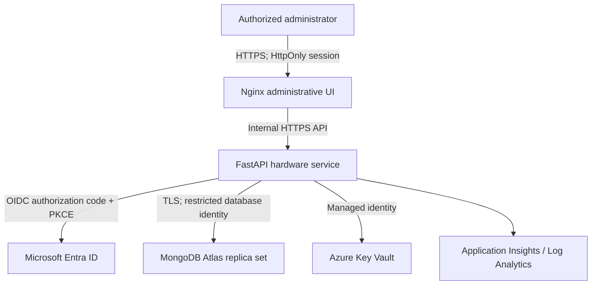

# Hardware Management Microservice

A FastAPI administrative API and a responsive, dependency-free browser UI. This repository owns hardware pools, project reservations, checkouts, returns and immutable application audit events. Project names, schedules, membership and onboarding remain in the project service.

## Architecture and choices



Only the UI has external Azure ingress. Nginx proxies `/auth/` and `/api/` to the internal API; browsers never receive database credentials, OAuth tokens or a database query interface. The server stores authentication state in MongoDB. The browser holds an opaque session identifier in an HttpOnly, SameSite=Lax cookie and a CSRF nonce in memory. A session cookie is necessarily a browser credential; JavaScript cannot read it. There is no localStorage/sessionStorage authentication or client-side OAuth.

Python 3.12 + FastAPI provides typed validation and generated OpenAPI. PyMongo provides real snapshot transactions and majority commits. Plain JavaScript avoids a frontend build chain and reduces maintenance. MongoDB Atlas preserves native MongoDB transaction semantics. Container Apps Consumption supports intermittent traffic and scale-to-zero; ACR Basic, Key Vault and a single logging workspace keep infrastructure small. The production network uses a NAT gateway with a stable egress IP restricted in Atlas. See [Azure guide](docs/AZURE.md) and [cost comparison](docs/COSTS.md).

## Inventory semantics

Each hardware record is a **pool of identical units**, with a globally unique, case-insensitive asset tag. A singleton with `total=1` represents a separately tagged device; serial is informational. Status applies to the entire pool. Split differently conditioned devices into separate pools through audited adjustments.

- `total`: physical quantity owned, including units checked out.
- `out`: quantity currently checked out.
- `available = total - out`: physical stock on hand, possibly reserved or inactive.
- `reserved`: sum of project allocation quantities, including their checked-out units.
- `unallocated = total - reserved`: stock available for a new project reservation.
- Per-project `quantity - out`: how many more units that project can check out.
- Invariant: `0 <= out <= reserved <= total`; each allocation satisfies `0 <= out <= quantity`.

Reserve stock before checkout. Reducing a reservation below its outstanding quantity fails. Reducing total below reserved stock fails. Non-active stock cannot be checked out; changing status requires all units returned. Retirement also requires releasing all reservations to zero and is irreversible. There is no destructive hardware deletion. Available **active** stock is shown separately on the dashboard.

Every mutation touches the hardware document, serializing competing operations on the same pool. It atomically writes hardware, allocations, checkout, audit and permanent idempotency receipt in one transaction. MongoDB retries transient transaction failures; stale administrator versions return HTTP 409. The application role has FIND/INSERT access to audit and request receipts, with no UPDATE/REMOVE privileges. Database owners can override database permissions; this is application-level append-only history, not regulatory WORM storage.

A pool supports up to 200 distinct project IDs, including historical zero allocations, to bound transaction size. API quantities are integers up to one million. The shared pool document deliberately favors correctness over very high write throughput. Shard by independent hardware pools if volumes grow; retain the tested transaction contract.

## Local setup

Prerequisites: Docker Engine/Desktop with Compose v2.24+ and Python 3.12+. Run commands from this directory.

```bash
python scripts/local-secrets.py
docker compose up -d --build --wait ui
```

Open http://localhost:8080/auth/login. This enables local development sign-in. Read the generated code from `.secrets/login-code` and enter it. The local code is generated, ignored by git and never written into `.env`. MongoDB and API have no published ports; the UI binds only to loopback. Local MongoDB enables authentication and a one-node replica set for transactions. Local HTTP is development-only; production requires HTTPS and disables local sign-in at application startup.

Optionally seed inventory through the API:

```bash
python -m venv .venv
. .venv/bin/activate
pip install -r backend/requirements-dev.txt
python scripts/seed.py
```

Seed requests use stable idempotency keys so rerunning them does not duplicate stock. Both the seed and ordinary administration produce audit events. Docker secrets are files under an ignored directory with mode 0700; individual files are readable by non-root containers. Do not loosen the directory permissions or share that directory.

Stop without deleting inventory: `docker compose down`. Permanently delete local inventory and its history: `docker compose down -v`. Reuse the original `.secrets` files with an existing MongoDB volume; replacing passwords does not change users already stored in that volume.

## Administrator usage

1. Dashboard: hardware record counts, total units, available active units, checked-out units, damaged and retired units, and the first 100 project summaries.
2. Hardware: search a case-insensitive name or asset-tag prefix, filter status and sort. Create pools; edit metadata or status; retire only after all returns and reservation releases.
3. Project inventory: select a known project ID from suggestions or enter its external ID. View hardware reservations and outstanding quantities. Set a reservation to zero to release it. Changes require the current hardware version and a reason. This screen cannot edit external project metadata.
4. Stock adjustments: enter a signed delta and a reason. Current totals are shown, followed by an explicit confirmation. Negative stock is rejected by both business rules and database validation.
5. Checkout management: filter outstanding records, process partial returns, or correct the **cumulative** returned quantity. Corrections can reopen a checkout only if active project capacity permits. No end-user checkout form exists in this UI.
6. Transaction history: filter hardware, project, administrator actor, borrower and timezone-aware date ranges. Expand before/after snapshots. Hardware and allocation rows link to their history. Borrower filtering applies to checkout/return/correction events; audit actor refers to the administrator making a change.

`Hardware.Admin` can mutate inventory. `Hardware.Auditor` is an administrative read-only role; controls disappear and API writes are denied. Both roles can sign out. All screens require authorization. Every mutating form requires a reason and confirmation. On HTTP 409 refresh the current screen before retrying. Network failures retain the same command key for a retry of the unchanged form.

## REST API

The checked-in [OpenAPI contract](openapi.json) documents all endpoints. After signing in, interactive Swagger UI is available at `/api/docs`; the authenticated `/api/openapi.json` endpoint emits the actual FastAPI schema. JSON uses `_id` for opaque IDs and `version` for optimistic concurrency. Hardware `available` and `unallocated` are derived by the single-item endpoint and UI.

| Method | Path | Behavior |
|---|---|---|
| GET | `/health`, `/ready` | Liveness and replica-set readiness; no inventory data |
| GET | `/auth/login`, `/auth/callback` | Backend OIDC login and validated callback |
| POST | `/auth/dev` | Local-only rate-limited sign-in |
| POST | `/auth/logout` | Delete server session and cookie |
| GET | `/api/me` | Current actor, roles and in-memory CSRF nonce |
| GET, POST | `/api/hardware` | Filter/list or create hardware |
| GET, PATCH | `/api/hardware/{hardware_id}` | Detail or metadata/status edit |
| GET | `/api/hardware/{hardware_id}/availability` | Inventory plus Azure SQL vendor alternatives when stock is zero |
| GET | `/api/docs` | Authenticated interactive Swagger UI |
| POST | `/api/hardware/{hardware_id}/retire` | Soft retirement, confirmed |
| POST | `/api/hardware/{hardware_id}/adjustments` | Signed total delta, confirmed |
| PUT | `/api/hardware/{hardware_id}/allocations/{project_id}` | Set project reserved quantity |
| GET | `/api/allocations` | Filter by hardware/project |
| POST, GET | `/api/checkouts` | Administrative API creation or filtered listing |
| POST | `/api/checkouts/{checkout_id}/returns` | Add to returned quantity |
| POST | `/api/checkouts/{checkout_id}/corrections` | Correct cumulative returned quantity, confirmed |
| GET | `/api/transactions` | Immutable inventory history |
| GET | `/api/summary` | Consistent dashboard snapshot |

All `/api/` operations and logout require a session. Writes also require `Origin` equal to `PUBLIC_ORIGIN`, `X-CSRF-Token` and a unique `Idempotency-Key` of 16–100 alphanumeric/underscore/hyphen characters. Logout requires CSRF and Origin but no idempotency key. The caller gets actor identity from the verified session; request bodies cannot choose an audit actor. Application callers must forward the authorized administrator's opaque session and CSRF nonce through their backend. This release exposes no client-credentials grant or end-user API role; do not put an administrative session in an end-user frontend.

When availability is zero, the availability endpoint performs a read-only lookup against the `dbo.unified_procurement` view populated by ADF. Docker Compose uses `backend/mock-sql-data.json` so this fallback can be tested without Azure. Azure deployments set `AZURE_SQL_SERVER`, `AZURE_SQL_DATABASE`, `AZURE_SQL_USER`, `AZURE_SQL_PASSWORD_FILE`, and `AZURE_SQL_TABLE`; adapt and run `scripts/azure-sql-schema.sql` first.

Create request:

```json
{"name":"Laptop pool","category":"Computers","description":"Engineering devices","asset_tag":"POOL-LAPTOP-02","serial":"","total":10,"reason":"Initial procurement"}
```

Example response (IDs vary):

```json
{"_id":"94dcd37d-501f-42fe-ad6b-fafcb732ae10","name":"Laptop pool","category":"Computers","description":"Engineering devices","asset_tag":"POOL-LAPTOP-02","serial":"","total":10,"status":"active","out":0,"reserved":0,"version":1,"name_key":"laptop pool","asset_key":"pool-laptop-02"}
```

Reserve via PUT with `{"quantity":4,"expected_version":1,"reason":"Engineering project"}`. Checkout via POST with the returned hardware ID, an external `project_id`, external `user_id`, positive `quantity` and `reason`. The server never modifies those external identities or verifies project membership; the owning integration must validate external identity existence and authorization. Check-in body: `{"quantity":1,"expected_version":1,"reason":"Partial equipment return"}`; expected_version here is the **checkout** version. Stock edit, adjustment, retirement and allocation bodies use the **hardware** version. Adjustment: `{"delta":-1,"expected_version":3,"reason":"Verified loss during stocktake","confirmed":true}`.

The same actor/key/body returns the saved response without another mutation, even if the record has since changed. Reusing a key with different route/body returns 409. Receipts have no TTL; plan their storage with audit retention. On an uncertain timeout/503 retry the exact same key/body. A changed intent requires a new key and current version.

Hardware queries: `q`, `category`, `status`, `sort=name_key|asset_key|status|total`, `direction=asc|desc`. Lists accept `page` (1-based) and `size` (1–100) and return `items,total,page,size`. Transactions additionally accept `project_id`, `hardware_id`, `actor_id`, `user_id`, `operation`, `start`, `end`. Timestamps must include a timezone, e.g. `2026-10-24T00:00:00Z`. Checkout list supports `user_id` and `outstanding=false` for all records. Maximum offset is 20,000: narrow indexed filters beyond this boundary. The UI uses pages of 25. Compound indexes cover common filters and stable ordering; mixed filters and outstanding `$expr` may still scan candidate records. Review explain plans before changing large-volume queries.

Failures: 401 missing/expired authentication; 403 role/origin/CSRF; 404 missing resource; 409 stale version, duplicate asset, overbooking or invariant violation; 422 invalid JSON/fields/quantity; 429 development login throttling; 503 database unavailable. Failed transactions leave no stock changes, audit event or receipt. Successful writes are recorded exactly once.

## Verification

Dependency-free invariant suite:

```bash
PYTHONPATH=backend python -m unittest discover -s backend/tests -p test_domain.py -v
```

Real MongoDB integration + browser end-to-end tests with coverage:

```bash
python scripts/local-secrets.py
docker compose up -d --build --wait ui
mkdir -p test-results
chmod 777 test-results
docker compose --profile test run --build --rm tests
```

The container runs pytest against a distinct `hardware_test` database and a real Chromium browser against the local UI. The test profile never receives production credentials. Tests cover CRUD, adjustments, allocations, overbooking under 20 concurrent requests, partial returns, corrections, stale/duplicate submissions, RBAC, CSRF, audit creation, database-level audit immutability, search/pagination and UI/API state changes. Unit tests do not substitute for database concurrency verification. Coverage appears in `test-results/coverage.xml` and JUnit in `test-results/junit.xml`; CI uploads both. No coverage threshold is claimed before the real suite is run.

Startup regression tests: `node --test scripts/tests/mongo-init.test.cjs`. These 10 tests exercise asynchronous ordering and error reporting using database test doubles; they do not replace the real MongoDB suite.

Lint/scanning: `ruff check backend scripts infra e2e`; `pip-audit -r backend/requirements.txt`; `node --check ui/app.js`. CI scans images with Trivy, blocks fixable High/Critical vulnerabilities, and deploys those exact image archives by registry digest. Unfixed image findings remain visible in scan output and require operator review. Dependency pins represent a baseline; automated scan results determine release eligibility.

Verification performed during generation: **29 dependency-free tests passed (24 inventory and 5 configuration tests)**, Python compilation and JavaScript/shell syntax checks passed. Docker, MongoDB, third-party Python packages and Azure credentials were unavailable in the generation environment; HTTP integration tests, browser tests, image builds/scans, coverage and Azure deployment are **not verified**. CI is provided to perform them. This is a production-oriented implementation, not a claim of a completed production acceptance exercise.

## Azure and GitHub

Follow [docs/AZURE.md](docs/AZURE.md) in order. It includes provisioning, Atlas, Entra application/role setup, Key Vault, deployment, monitoring, GitHub OIDC, rollback and cleanup. [docs/COSTS.md](docs/COSTS.md) compares hosting/database choices and models recurring charges. No cloud resources are created merely by reading or opening this repository.

Create a private repository named `hardware-management-service`, add the files, then push a `develop` branch and `main`. Use short-lived `feature/...` branches into `develop`. Protect both long-lived branches with pull requests and required `verify` checks; protect `main` with review and no force push. GitHub environments named exactly `dev` and `prod` select independent resource groups, databases, Entra apps and deployment identities. Configure required reviewers and main-only deployment branch protection on prod. Never grant an untrusted PR access to an environment or OIDC deployment role. Enable dependency update PRs with the included Dependabot configuration.

## Troubleshooting and operating limits

- Startup refuses missing Mongo/OIDC settings, non-HTTPS production configuration, production dev codes, and non-loopback local origins. The readiness endpoint rejects a standalone MongoDB server; run the provided replica set.
- Init logs contain only `<anonymous_script>:3`: use the updated `scripts/init-db.js`, `scripts/schema.js` and Compose file. The schema now explicitly awaits asynchronous calls; initialization prints its current stage and a JSON error before exiting. Recreate only the init container with `docker compose up -d --force-recreate init`, then retry startup. Keep the existing secret files and database volume.
- Mongo authentication failure after regenerating secrets: restore the old secret files, or intentionally remove the local volume and start from empty inventory.
- 409 stale version: refresh the affected hardware/checkout; do not silently overwrite another administrator's changes.
- Cannot retire: return checkouts, release each project's allocation to zero, refresh hardware version, then retire.
- 403 after sign-in: assign an Entra application role; sign out and in again. Sessions have a fixed one-hour expiry. Role revocation takes effect at the next login or session expiry; an operator can remove the actor's session documents for immediate revocation.
- OIDC mismatch: check the exact HTTPS UI origin and callback path in Entra, issuer tenant and client ID; verify no HTTP/HTTPS redirect loop. Client credentials expire after one year; rotate sooner using the same Key Vault secret name.
- Atlas connection failure: allow only the NAT IP /32, check DNS/TLS and URI encoding, and verify custom roles. Never solve it with `0.0.0.0/0`.
- Nginx 502/504: check internal API FQDN, platform DNS, upstream certificate and readiness. Scale-from-zero can add cold-start latency; increase API minimum replicas to one only if required by measured latency.
- Failed release: inspect Trivy/pip-audit findings and update pins/base images before rerunning. Do not disable the gate to force a release.
- MongoDB owner credentials stay with provisioning operators, never in the app or CI deployment environment. Application sessions/receipts share the database, eliminating a separate cache service.
- There is no batch import/export, external project metadata editor, background worker, public checkout UI, message broker or Kubernetes dependency. Signed-in app traffic is same-origin; there is no permissive CORS setting.
- Backups need a tested restore procedure. Restore Atlas snapshots into an isolated cluster, reapply the restricted app role, verify stock/allocation/checkout invariants and audit counts, then deliberately switch the Key Vault URI and revision. Review backup retention and perform a restore drill before production acceptance.
