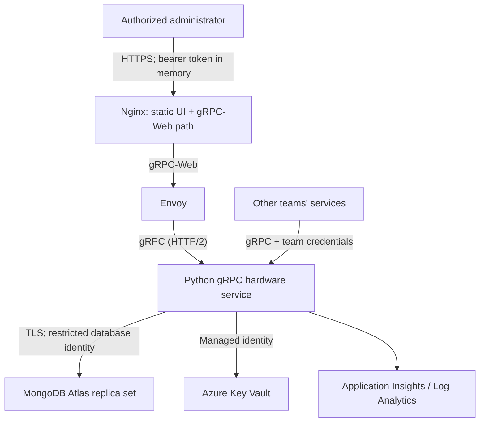

# Hardware Management Microservice

A gRPC hardware service and a responsive, dependency-free browser administration UI. This repository owns hardware pools, project reservations, checkouts, returns and immutable application audit events. Project names, schedules, membership and onboarding remain in the project service. The contract is [`proto/hardware/v1/hardware.proto`](proto/hardware/v1/hardware.proto); there is no REST API.

## Architecture and choices



Browsers cannot speak native gRPC, so the website reaches the service through Envoy, which translates gRPC-Web to gRPC; Nginx serves the static files and forwards `/hardware.v1.*` calls to Envoy. Other teams call the gRPC port directly with their team credentials. The server stores sessions in MongoDB. Signing in returns an opaque bearer token that the browser keeps **in memory only** (reloading the page signs out) and sends in the `authorization` metadata, so there are no cookies and no CSRF surface. Browsers never receive database credentials or a database query interface. The old Entra/OIDC browser redirect flow was removed: it has no gRPC equivalent, so website sign-in is by team name and code.

Python 3.12 + grpcio serves the contract; pydantic validates every request and PyMongo provides real snapshot transactions and majority commits. Plain JavaScript with a small generated-schema gRPC-Web codec (`ui/rpc.js`) avoids a frontend build chain. MongoDB Atlas preserves native MongoDB transaction semantics. Container Apps Consumption supports intermittent traffic and scale-to-zero; ACR Basic, Key Vault and a single logging workspace keep infrastructure small. The production network uses a NAT gateway with a stable egress IP restricted in Atlas. See [Azure guide](docs/AZURE.md) and [cost comparison](docs/COSTS.md).

## Inventory semantics

Each hardware record is a **pool of identical units**, with a globally unique, case-insensitive asset tag. A singleton with `total=1` represents a separately tagged device; serial is informational. Status applies to the entire pool. Split differently conditioned devices into separate pools through audited adjustments.

- `total`: physical quantity owned, including units checked out.
- `out`: quantity currently checked out.
- `available = total - out`: physical stock on hand, possibly reserved or inactive.
- `reserved`: sum of project allocation quantities, including their checked-out units.
- `unallocated = total - reserved`: stock available for a new project reservation.
- Per-project `quantity - out`: how many more units that project can check out.
- Invariant: `0 <= out <= reserved <= total`; each allocation satisfies `0 <= out <= quantity`.

Reserve stock before checkout. Reducing a reservation below its outstanding quantity fails. Reducing total below reserved stock fails. Non-active stock cannot be checked out; changing status requires all units returned. Retirement also requires releasing all reservations to zero and is irreversible. There is no destructive hardware deletion. Available **active** stock is shown separately on the dashboard.

Every mutation touches the hardware document, serializing competing operations on the same pool. It atomically writes hardware, allocations, checkout, audit and permanent idempotency receipt in one transaction. MongoDB retries transient transaction failures; stale administrator versions return HTTP 409. The application role has FIND/INSERT access to audit and request receipts, with no UPDATE/REMOVE privileges. Database owners can override database permissions; this is application-level append-only history, not regulatory WORM storage.

A pool supports up to 200 distinct project IDs, including historical zero allocations, to bound transaction size. API quantities are integers up to one million. The shared pool document deliberately favors correctness over very high write throughput. Shard by independent hardware pools if volumes grow; retain the tested transaction contract.

## Local setup

Prerequisites: Docker Engine/Desktop with Compose v2.24+ and Python 3.12+. Run commands from this directory.

```bash
python scripts/local-secrets.py
docker compose up -d --build --wait ui
```

Open http://localhost:8080/?local=1. This shows the local development sign-in. Read the generated code from `.secrets/login-code` and enter it (or sign in as `hardware-admin` with the code in `.secrets/team-hardware-admin`). The local code is generated, ignored by git and never written into `.env`. MongoDB and Envoy have no published ports; the UI (8080) and the native gRPC port (50051) bind only to loopback. Local MongoDB enables authentication and a one-node replica set for transactions. Local HTTP/plaintext gRPC is development-only; production requires TLS at the platform edge and disables local sign-in at application startup.

Optionally seed inventory through the API:

```bash
python -m venv .venv
. .venv/bin/activate
pip install -r backend/requirements-dev.txt
python scripts/seed.py
```

Seed requests use stable request numbers so rerunning them does not duplicate stock. The seed script calls the gRPC port as the `hardware-admin` team and needs the generated stubs first: `python scripts/generate-proto.py`. Both the seed and ordinary administration produce audit events. Docker secrets are files under an ignored directory with mode 0700; individual files are readable by non-root containers. Do not loosen the directory permissions or share that directory.

Stop without deleting inventory: `docker compose down`. Permanently delete local inventory and its history: `docker compose down -v`. Reuse the original `.secrets` files with an existing MongoDB volume; replacing passwords does not change users already stored in that volume.

## Administrator usage

1. Dashboard: hardware record counts, total units, available active units, checked-out units, damaged and retired units, and the first 100 project summaries.
2. Hardware: search a case-insensitive name or asset-tag prefix, filter status and sort. Create pools; edit metadata or status; retire only after all returns and reservation releases.
3. Project inventory: select a known project ID from suggestions or enter its external ID. View hardware reservations and outstanding quantities. Set a reservation to zero to release it. Changes require the current hardware version and a reason. This screen cannot edit external project metadata.
4. Stock adjustments: enter a signed delta and a reason. Current totals are shown, followed by an explicit confirmation. Negative stock is rejected by both business rules and database validation.
5. Checkout management: filter outstanding records, process partial returns, or correct the **cumulative** returned quantity. Corrections can reopen a checkout only if active project capacity permits. No end-user checkout form exists in this UI.
6. Transaction history: filter hardware, project, administrator actor, borrower and timezone-aware date ranges. Expand before/after snapshots. Hardware and allocation rows link to their history. Borrower filtering applies to checkout/return/correction events; audit actor refers to the administrator making a change.

`Hardware.Admin` can mutate inventory. `Hardware.Auditor` is an administrative read-only role (for sessions that carry it; website sign-in grants `Hardware.Admin`); controls disappear and writes are denied. Both roles can sign out. All screens require authorization. Every mutating form requires a reason and confirmation. On ABORTED or FAILED_PRECONDITION (a stale version or a broken stock rule) refresh the current screen before retrying. Network failures retain the same request number for a retry of the unchanged form.

## gRPC API

The contract is [`proto/hardware/v1/hardware.proto`](proto/hardware/v1/hardware.proto): `HardwareService` (inventory), `AuthService` (website sign-in) and `OpsService` (readiness), plus the standard `grpc.health.v1.Health`. Other teams generate a client from that file and call the service with their team name and code; see [Team access](docs/SERVICE-API.md) for credentials, request numbers and examples, and the [Response guide](docs/API-RESPONSES.md) for what every response field means.

| RPC | Behavior |
|---|---|
| `HardwareService.CreateHardware` | Create a hardware pool (admin) |
| `ListHardware`, `GetHardware` | Filter/list and detail; both include derived `available` and `unallocated` |
| `GetAvailability` | Inventory plus Azure SQL vendor alternatives when stock is zero |
| `UpdateHardware`, `RetireHardware`, `AdjustHardware` | Metadata/status edit, soft retirement, signed total delta (admin; the last two need `confirmed`) |
| `AllocateHardware` | Set a project's reserved quantity |
| `ListAllocations` | Filter by hardware/project |
| `CreateCheckout`, `ListCheckouts` | Check out stock; filtered listing (outstanding only by default) |
| `ReturnCheckout` | Add to the returned quantity |
| `CorrectCheckout` | Set the cumulative returned quantity (admin, `confirmed`) |
| `ListTransactions` | Immutable inventory history |
| `GetSummary` | Consistent dashboard snapshot |
| `AuthService.GetAuthMethods`, `Login`, `DevLogin`, `Logout`, `Me` | Website sign-in; `DevLogin` is local-only and rate limited |
| `OpsService.Ready`, `grpc.health.v1.Health/Check` | Replica-set readiness; liveness |

Authentication is the `authorization` metadata entry: `Basic base64(team:code)` for service teams or `Bearer <token>` from `Login`. Every mutating RPC takes a unique `request_id` field (or the `idempotency-key` metadata entry; if both are sent they must match). The caller's identity comes from the credentials; request bodies cannot choose an audit actor. This release exposes no client-credentials grant or end-user role; do not put team codes in an end-user frontend.

When availability is zero, `GetAvailability` performs a read-only lookup against the `dbo.unified_procurement` view populated by ADF. Docker Compose uses `backend/mock-sql-data.json` so this fallback can be tested without Azure. Azure deployments set `AZURE_SQL_SERVER`, `AZURE_SQL_DATABASE`, `AZURE_SQL_USER`, `AZURE_SQL_PASSWORD_FILE`, and `AZURE_SQL_TABLE`; adapt and run `scripts/azure-sql-schema.sql` first.

Try it from the host (generate the stubs first with `python scripts/generate-proto.py`):

```python
import base64, grpc
from hardware.v1 import hardware_pb2 as pb, hardware_pb2_grpc as rpc   # PYTHONPATH=backend

code = open('.secrets/team-hardware-admin').read().strip()
auth = (('authorization', 'Basic ' + base64.b64encode(f'hardware-admin:{code}'.encode()).decode()),)
stub = rpc.HardwareServiceStub(grpc.insecure_channel('localhost:50051'))
pool = stub.CreateHardware(pb.CreateHardwareRequest(
    name='Laptop pool', category='Computers', asset_tag='POOL-LAPTOP-02', total=10,
    reason='Initial procurement', request_id='create-laptop-pool-1'), metadata=auth)
stub.AllocateHardware(pb.AllocateHardwareRequest(
    hardware_id=pool.id, project_id='proj-1', quantity=4, reason='Engineering project',
    request_id='alloc-1'), metadata=auth)
```

Allocation sets the quantity (it does not add). Checkout needs the returned hardware `id`, an external `project_id`, external `user_id`, positive `quantity` and `reason`. The server never modifies those external identities or verifies project membership; the owning integration must validate external identity existence and authorization. `ReturnCheckout`'s `expected_version` is the **checkout** version; stock edit, adjustment, retirement and allocation use the **hardware** version.

The same actor + request number + fields returns the saved response without another mutation, even if the record has since changed. Reusing a request number with different fields fails with `ALREADY_EXISTS`. Receipts have no TTL; plan their storage with audit retention. On an uncertain timeout or `UNAVAILABLE`, retry the exact same request. A changed intent requires a new request number and current version.

List RPCs take `page` (1-based) and `size` (1-100) and return `items,total,page,size`. `ListHardware` accepts `q`, `category`, `status`, `sort` (`name_key|asset_key|status|total`) and `direction`. `ListTransactions` additionally accepts `project_id`, `hardware_id`, `actor_id`, `user_id`, `operation`, and `start`/`end` timestamps. `ListCheckouts` supports `user_id` and `outstanding=false` for all records. Maximum offset is 20,000: narrow indexed filters beyond this boundary. The UI uses pages of 25. Compound indexes cover common filters and stable ordering; mixed filters and outstanding `$expr` may still scan candidate records. Review explain plans before changing large-volume queries.

Status codes: `UNAUTHENTICATED` missing/expired/wrong credentials; `PERMISSION_DENIED` the team or role may not call the RPC; `NOT_FOUND` missing resource; `INVALID_ARGUMENT` bad or missing fields; `ABORTED` stale version or concurrent change (refresh and retry); `FAILED_PRECONDITION` overbooking or another stock-rule violation; `ALREADY_EXISTS` duplicate asset tag or reused request number; `RESOURCE_EXHAUSTED` sign-in throttling or an oversized request; `UNAVAILABLE` database unavailable. Failed transactions leave no stock changes, audit event or receipt. Successful writes are recorded exactly once.

## Verification

Dependency-free invariant suite:

```bash
PYTHONPATH=backend python -m unittest discover -s backend/tests -p test_domain.py -v
```

Real MongoDB integration (a real gRPC server and channel) + browser end-to-end tests with coverage:

```bash
python scripts/local-secrets.py
docker compose up -d --build --wait ui
mkdir -p test-results
chmod 777 test-results
docker compose --profile test run --build --rm tests
```

The container runs pytest against a distinct `hardware_test` database and a real Chromium browser against the local UI (Nginx to Envoy to gRPC), plus a native gRPC client against the API container. The test profile never receives production credentials. Tests cover CRUD, adjustments, allocations, overbooking under 20 concurrent requests, partial returns, corrections, stale/duplicate submissions, team permissions, sessions, audit creation, database-level audit immutability, search/pagination and UI/API state changes and the response shape of every RPC. Unit tests do not substitute for database concurrency verification. Coverage appears in `test-results/coverage.xml` and JUnit in `test-results/junit.xml`; CI uploads both. No coverage threshold is claimed before the real suite is run.

Browser codec test (checks `ui/rpc.js` against golden bytes from the real protobuf library): `python scripts/generate-ui-schema.py && node --test scripts/tests/rpc-codec.test.cjs`. Startup regression tests: `node --test scripts/tests/mongo-init.test.cjs`. These 10 tests exercise asynchronous ordering and error reporting using database test doubles; they do not replace the real MongoDB suite.

Lint/scanning: `ruff check backend scripts infra e2e`; `pip-audit -r backend/requirements.txt`; `node --check ui/app.js`; `node --check ui/rpc.js`. CI scans images with Trivy, blocks fixable High/Critical vulnerabilities, and deploys those exact image archives by registry digest. Unfixed image findings remain visible in scan output and require operator review. Dependency pins represent a baseline; automated scan results determine release eligibility.

Verification performed for the gRPC migration: the full suite above passed in Docker Compose against real MongoDB, Envoy and Nginx (82 tests: unit tests, 21 real-database gRPC integration tests, a Chromium UI round trip and a native gRPC client test), plus `ruff`, the JavaScript codec tests and a host-side seed run over the published gRPC port. Image vulnerability scans and Azure deployment are **not verified** here; CI performs the scans. The Azure deployment files still describe the previous REST layout (see Azure and GitHub below).

## Azure and GitHub

> **Two-app Container Apps layout (works on a standard Consumption environment, not express).** `hardware-api` runs `Dockerfile.azure` with external ingress, transport `http2`, target port `50051`; it is what other teams and Postman call over native gRPC. `hardware-web` runs `web/Dockerfile` with external HTTP/1 ingress on target port `8080` and the environment variable `API_HOST` set to the API app's hostname; it serves the website and translates gRPC-Web to the API over TLS. `container-image.yml` publishes both images. The web image was verified locally against Docker Compose and its Envoy config was validated for TLS; the Azure deployment itself is not verified. The files below still describe the old layout.
>
> **Not yet migrated to gRPC.** The gRPC migration was built and verified with Docker Compose. `docs/AZURE.md`, `infra/deploy.py`, `.github/workflows/azure-appservice.yml` and the deploy job of `ci-cd.yml` still describe the earlier REST layout (one FastAPI container on port 8000 with HTTP probes, Entra sign-in, and an App Service that cannot serve gRPC). Before deploying: add an Envoy container app, set the API ingress to HTTP/2 on target port 50051 with gRPC health probes, point Nginx at Envoy, drop the Entra application setup, and retire the App Service workflow. Do not run those workflows against this code unchanged.

Follow [docs/AZURE.md](docs/AZURE.md) in order. It includes provisioning, Atlas, Entra application/role setup, Key Vault, deployment, monitoring, GitHub OIDC, rollback and cleanup. [docs/COSTS.md](docs/COSTS.md) compares hosting/database choices and models recurring charges. No cloud resources are created merely by reading or opening this repository.

Create a private repository named `hardware-management-service`, add the files, then push a `develop` branch and `main`. Use short-lived `feature/...` branches into `develop`. Protect both long-lived branches with pull requests and required `verify` checks; protect `main` with review and no force push. GitHub environments named exactly `dev` and `prod` select independent resource groups, databases, Entra apps and deployment identities. Configure required reviewers and main-only deployment branch protection on prod. Never grant an untrusted PR access to an environment or OIDC deployment role. Enable dependency update PRs with the included Dependabot configuration.

## Troubleshooting and operating limits

- Startup refuses missing Mongo settings, a non-SRV or insecure production Mongo URI, short team codes, a production without `TEAM_CODE_HARDWARE_ADMIN`, and production dev codes. The readiness endpoint rejects a standalone MongoDB server; run the provided replica set.
- Init logs contain only `<anonymous_script>:3`: use the updated `scripts/init-db.js`, `scripts/schema.js` and Compose file. The schema now explicitly awaits asynchronous calls; initialization prints its current stage and a JSON error before exiting. Recreate only the init container with `docker compose up -d --force-recreate init`, then retry startup. Keep the existing secret files and database volume.
- Mongo authentication failure after regenerating secrets: restore the old secret files, or intentionally remove the local volume and start from empty inventory.
- `ABORTED` stale version: refresh the affected hardware/checkout; do not silently overwrite another administrator's changes.
- Cannot retire: return checkouts, release each project's allocation to zero, refresh hardware version, then retire.
- `PERMISSION_DENIED` after sign-in or from a team: check the team's permissions in `backend/app/teams.py`. Sessions have a fixed one-hour expiry; an operator can remove the actor's documents from the `sessions` collection for immediate revocation. Website sign-in uses team name and code (only teams with `ui: True`).
- `UNAUTHENTICATED` from a service team: the name/code pair is wrong or the team's `TEAM_CODE_*` variable is empty. Twenty failures in five minutes from one address return `RESOURCE_EXHAUSTED`.
- Atlas connection failure: allow only the NAT IP /32, check DNS/TLS and URI encoding, and verify custom roles. Never solve it with `0.0.0.0/0`.
- Nginx 502/504 or a blank UI after sign-in: check that the `envoy` container is healthy (`docker compose ps`) and that Envoy can reach `api:50051`; `curl http://localhost:8080/ready` returns 200 only when Envoy's gRPC health check on the API passes. Scale-from-zero can add cold-start latency; increase API minimum replicas to one only if required by measured latency.
- Failed release: inspect Trivy/pip-audit findings and update pins/base images before rerunning. Do not disable the gate to force a release.
- MongoDB owner credentials stay with provisioning operators, never in the app or CI deployment environment. Application sessions/receipts share the database, eliminating a separate cache service.
- There is no batch import/export, external project metadata editor, background worker, public checkout UI, message broker or Kubernetes dependency. Browser traffic is same-origin through Nginx; there is no permissive CORS setting.
- Backups need a tested restore procedure. Restore Atlas snapshots into an isolated cluster, reapply the restricted app role, verify stock/allocation/checkout invariants and audit counts, then deliberately switch the Key Vault URI and revision. Review backup retention and perform a restore drill before production acceptance.
